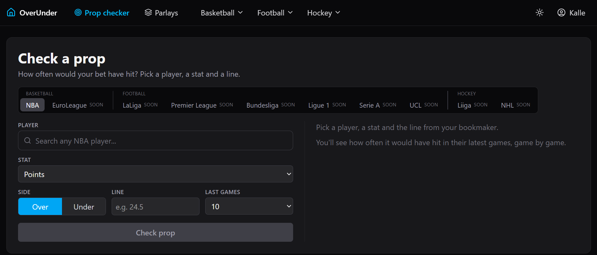
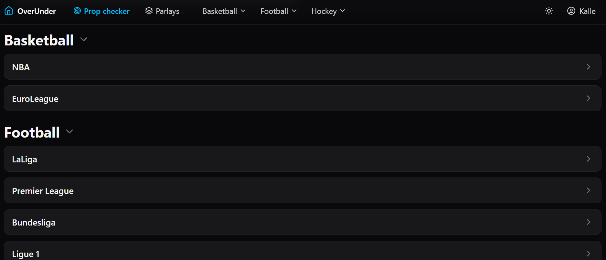
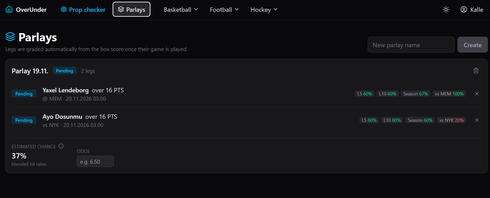
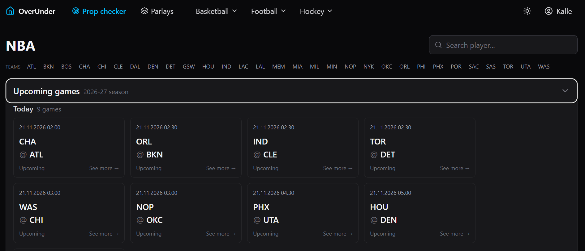
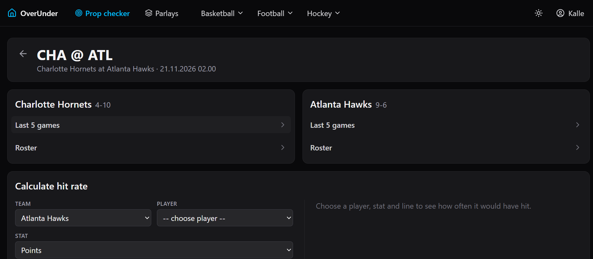
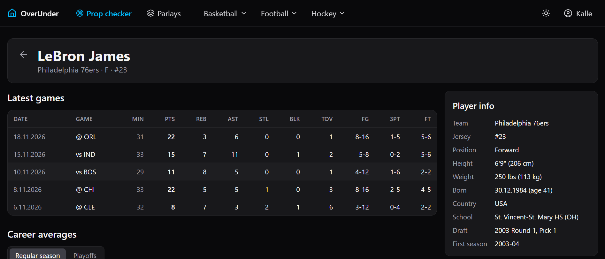
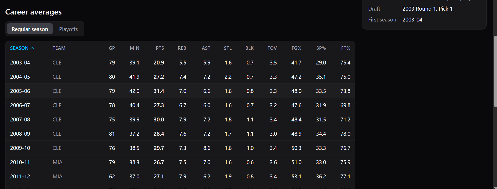

# OverUnder

## Description

OverUnder is a general sports site, which includes information about your favorite sports. What makes it special, is the prop checker, to check the probabilities of a bet before you make it. This is a work in progress, so new features are being implemented constantly. 

## Stack

- **Client:** React 19, TypeScript, Vite, Tailwind CSS v4, React Router, lucide-react icons. Tested with Vitest and Testing Library, linted with oxlint.
- **Server:** Node.js 22, Express, TypeScript run with tsx, postgres.js for queries.
- **Auth:** Better Auth with email and password, stored in Postgres through Kysely.
- **Database:** PostgreSQL 17, with migrations run by Flyway.
- **Data collector:** Python 3.12 with kagglehub and psycopg. It loads NBA box scores and schedules from Kaggle and syncs the current season daily.
- **Infrastructure:** Docker Compose runs every service.

## Screenshots

- Homepage:




- Parlays page:


- Nba page:


- Game page:


- Player page:



## Running locally

### Requirements

- [Docker](https://docs.docker.com/get-docker/) with Docker Compose
- A [Kaggle](https://www.kaggle.com/) account and API token (the NBA data is downloaded from Kaggle)

### 1. Clone the repository

```bash
git clone https://github.com/KalleLuukkanen/OverUnder.git
cd OverUnder
```

### 2. Create `project.env`

Create a file called `project.env` in the project root. It isn't in git because it holds passwords and keys.

```env
POSTGRES_USER=username
POSTGRES_PASSWORD=password
POSTGRES_DB=database

FLYWAY_USER=username
FLYWAY_PASSWORD=password
FLYWAY_URL=jdbc:postgresql://database:5432/database

PGUSER=username
PGPASSWORD=password
PGDATABASE=database
PGHOST=database
PGPORT=5432

BETTER_AUTH_SECRET=<random string, at least 32 characters>
BETTER_AUTH_URL=http://localhost:8000

KAGGLE_USERNAME=<your Kaggle username>
KAGGLE_KEY=<your Kaggle API key>
```

- The database user, password and name must match across the `POSTGRES_`, `FLYWAY_` and `PG` variables. The database name also goes at the end of `FLYWAY_URL`.
- Generate `BETTER_AUTH_SECRET` with, for example, `openssl rand -base64 32`.
- Get the Kaggle key from Kaggle → Settings → API → Create New Token.

### 3. Start the app

```bash
docker compose up -d
```

This starts the following:

- the database, with migrations applied automatically
- the server at http://localhost:8000
- the client at http://localhost:5173
- a daily sync of the current NBA season

### 4. Load NBA data

The database starts empty. This command loads the previous and current season:

```bash
docker compose run --rm nba-ingest
```

To load past seasons for the historical search (all the way back to 1996-97), run:

```bash
docker compose run --rm nba-ingest python -m collectors.nba_collector --since 1996-97
```

The full backfill takes a while. To load only specific seasons, run:

```bash
docker compose run --rm nba-ingest python -m collectors.nba_collector --seasons 2024-25 2025-26
```

### 5. Open the app

Go to http://localhost:5173. Sign up for an account to use past seasons and parlays.

### Stopping

```bash
docker compose stop     # stop the app, keep the data (start again with docker compose up -d)
docker compose down -v  # remove the containers and delete the database
```
